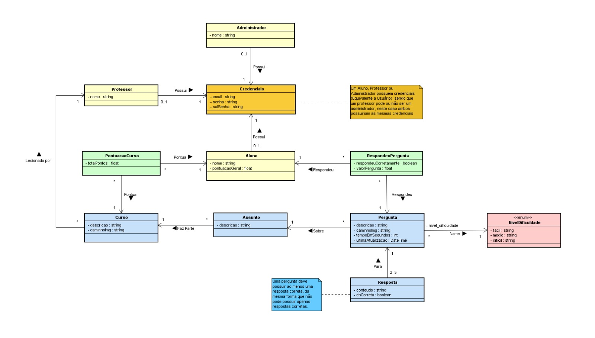

# Projeto 

**CEFET/RJ – Nova Friburgo**
**Bacharelado em Sistemas de Informação**

_Projeto ACME Quiz, desenvolvido para a disciplina de Projeto Integrador de Sistemas 2025.2._

---

## 👨‍💻 Desenvolvedores

- [Gabriel Guerço](https://github.com/Guerco)
- [Mychelle Satyn](https://github.com/MychelleSatyn)

---

## 🌐 Tecnologias utilizadas

### Frontend 🎨

**🔧 Linguagens e Ferramentas:**

- HTML
- CSS
- TypeScript
- PNPM v10.17.1

**📚 Bibliotecas e Frameworks TypeScript:**

- json-server v1.0.0-beta.3
- playwright v1.55.1
- vite v6.3.6
- vitest v3.2.4
- execa v9.6.0
- chart.js v4.5.1

---

### Backend 🛠️

**🔧 Linguagens e Ferramentas:**

- PHP v8.2.4
- Composer v2.7.6

**📚 Bibliotecas e Frameworks PHP:**

- phputil/router v0.3.6
- phputil/cors v0.5.3
- kahlan/kahlan v6.0
- phpstan/phpstan v2.1

---

## Primeiros Passos 🏃‍♂️

Para aprender a instalar e executar o projeto, consulte o guia completo em [Instruções de Rodagem.](./doc/instrucoes.md)

---

## Estrutura de Diretórios 🗃

| **📂**                                       | **Descrição**                                           |
| -------------------------------------------- | ------------------------------------------------------- |
| [/doc/](./doc/)                              | Documentação do projeto                                 |
| [/api/](./api/)                              | Implementação da API                                    |
| [/frontend/](./frontend/)                    | Implementação do frontend                               |
| 🛠️**Estrutura da API**                       |                                                         |
| [/src/](./api/src/)                          | Código-fonte da API                                     |
| [/src/model](./api/src/model/)               | Modelos de dados, acesso a dados e lógica de negócio    |
| [/db/](./api/db/)                            | Scripts de Banco de Dados                               |
| [/json-server/](./api/json-server/)          | API simulada                                            |
| [/spec/](./api/spec)                         | Testes automatizados da API                             |
| [/img/](./api/img/)                          | Figuras de Cursos e Perguntas                           |
| 🎨**Estrutura do Frontend**                  |                                                         |
| [/src/](./frontend/src/)                     | Código-fonte do frontend                                |
| [/src/model/](./frontend/src/model/)         | Modelos de dados, interação com API e lógica de negócio |
| [/src/view/](./frontend/src/view/)           | Camada de visualização e manipulação do DOM             |
| [/src/presenter/](./frontend/src/presenter/) | Controladores da aplicação                              |
| [/src/util/](./frontend/src/util/)           | Funções utilitárias                                     |
| [/test/](./frontend/test/)                   | Testes automatizados da aplicação                       |
| [/test/e2e/](./frontend/test/e2e/)           | Testes end-to-end                                       |
| [/test/unit/](./frontend/test/unit/)         | Testes unitários e de integração                        |
| [/pages/](./frontend/pages/)                 | Páginas da aplicação                                    |
| [/style/](./frontend/style/)                 | Arquivos de Estilização das Páginas                     |
| [/img/](./frontend/img/)                     | Imagens e logotipos exibidas na aplicação               |

---

## Estrutura de Dados 🎲

---

## Referências de Conteúdo 📚

Todas as referências a imagens, conteúdos e estilos **externos** utilizados neste projeto encontram-se na [Documentação de Referências](./doc/referencias.md).

---

## Slides de Apresentação 🖥️

[Clique para visualizar os slides de apresentação para P1](./doc/apresentacao/slides-p1.pdf)

---

---

---
