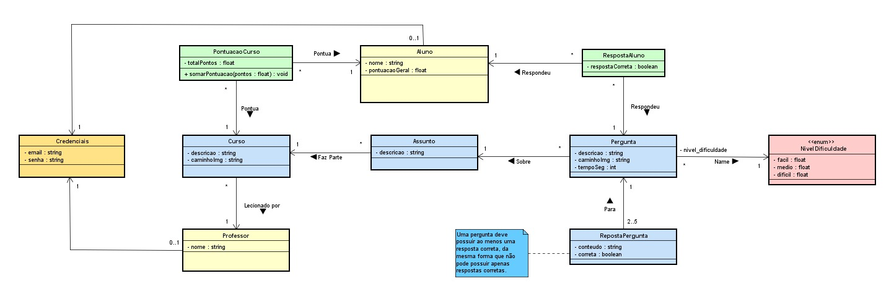

# Projeto 

**CEFET/RJ – Nova Friburgo**
**Bacharelado em Sistemas de Informação**

*Projeto ACME Quiz, desenvolvido para a disciplina de Projeto Integrador de Sistemas 2025.2.*

---

## Desenvolvedores 👨‍💻

- [Gabriel Guerço](https://github.com/Guerco)
- [Mychelle Satyn](https://github.com/MychelleSatyn)

---

## 🌐 Tecnologias utilizadas

### Frontend 🎨

**🔧 Linguagens e Ferramentas:**

- HTML
- CSS
- TypeScript
- PNPM v10.17.1

**📚 Bibliotecas e Frameworks JavaScript:**

- json-server v1.0.0-beta.3
- playwright v1.55.1
- vite v6.3.6
- vitest v3.2.4

---

### Backend 🛠️

**🔧 Linguagens e Ferramentas:**

- PHP v8.2.4
- Composer v2.7.6

**📚 Bibliotecas e Frameworks PHP:**

- phputil/router v0.3.6
- phputil/cors v0.5.3
- kahlan/kahlan v6.0
- phpstan/phpstan v2.1

---

## Estrutura de Diretórios arqui

| **📂**                             | **Descrição**                           |
| ---------------------------------------- | ----------------------------------------------- |
| [/doc](./doc/)                              | Documentação do projeto                       |
| [/api](./api/)                              | Implementação da API                          |
| [/frontend](./frontend/)                    | Implementação do frontend                     |
| 🛠️**Estrutura da API**           |                                                 |
| [/json-server/](./api/json-server/)         | API simulada                                    |
| 🎨**Estrutura do Frontend**        |                                                 |
| [/src/](./frontend/src/)                    | Código-fonte do frontend                       |
| [/src/model/](./frontend/src/model)         | Modelos de dados e lógica de negócio          |
| [/src/view/](./frontend/src/view)           | Camada de visualização e manipulação do DOM |
| [/src/presenter/](./frontend/src/presenter) | Controladores da aplicação                    |
| [/src/util/](./frontend/src/util)           | Funções utilitárias                          |
| [/test/](./frontend/test/)                  | Testes automatizados da aplicação             |
| [/test/e2e/](./frontend/test/e2e)           | Testes end-to-end                               |
| [/test/unit/](./frontend/test/unit)         | Testes unitários e de integração             |

---

## Estrutura de Dados 🎲

---

## Referências de Conteúdo

Todas as referências a imagens, conteúdos e estilos **externos** utilizados neste projeto encontram-se na [Documentação de Referências](./doc/referencias.md).

---

---
---